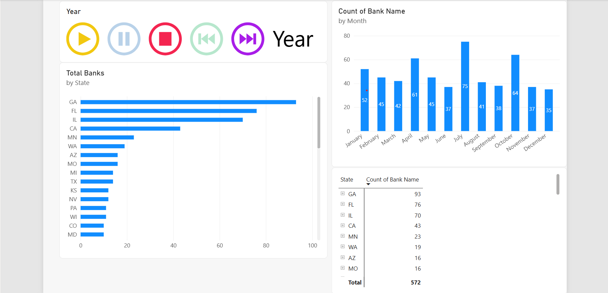

# 📊 Power BI Beginner to Pro (2026 Edition) — Completed Course Project

This repository houses my completed hands-on project and dashboards built during the **Free Event: Power BI Beginner to Pro 2026 Edition** intensive tutorial hosted by **Pragmatic Works**.

---

## 🏦 Completed Project: Bank Branch Location Strategy
**Scenario:** Acted as a Data Analyst tasked by bank leadership to identify optimal geographic regions for expanding and opening new bank branches based on federal deposit data.

* **Data Source:** Live Federal Deposit Insurance Corporation web data ([fdic.gov](https://fdic.gov))
* **Methods & Architecture Implemented:**
  * **Data Ingestion:** Connected Power BI Desktop directly to the live FDIC web URL endpoint.
  * **ETL & Data Cleansing:** Structured, filtered, and cleaned regulatory banking records inside `Power Query`.
  * **Data Modeling:** Generated a custom, unbroken Date dimension table and constructed active **One-to-Many relationships** to establish a robust, industry-standard Star Schema model.
  * **Report Design:** Applied an executive global color theme to style the analytics canvas.

* **Project Development Status:**
  * [x] **Stage 1: Data Connection & Ingestion** — Linked live FDIC data sources.
  * [x] **Stage 2: Advanced Transformations & Modeling** — Established calendar structures and relational modeling.
  * [x] **Stage 3: Core Report Development** — Programmed interactive Stacked Column and Stacked Bar charts.
  * [x] **Stage 4: Tabular Analysis** — Deployed matrix visuals for granular data drill-downs.
  * [x] **Stage 5: Visual Styling** — Implemented cohesive report layout and theme formatting.

* **Final Desktop Dashboard Layout:**
  * **Geographic Volume Distributions:** High-level column and bar charts comparing branch footprint across individual states.
  * **Granular Matrix Metrics:** Comprehensive tabular matrices grouping counts of bank records dynamically by location.
  * **Relational Backbone:** Fully independent Calendar lookup table properly mapped to core data rows via One-to-Many linkages.

> 💡 *The finalized local project file `FDIC_Bank_Location_Analysis.pbix` is tracked above and ready for local desktop analysis.*
### 🖼️ Desktop Analytics View

---

## 📚 Course Curriculum Completed

- [x] **Module 1: Connecting & Ingesting Data** — Connected live to the FDIC web URL source.
- [x] **Module 2: Data Cleansing & Transformation** — Performed ETL processes using Power Query.
- [x] **Module 3: Data Modeling** — Created standard relationships between data tables.
- [x] **Module 4: DAX Basics** — Implemented calculated metrics for banking entries.
- [x] **Module 5: Data Visualization** — Designed interactive matrix layouts and charts utilizing a global theme.

## 🛠️ Tools & Technologies Used
* **Power BI Desktop** (Data Modeling & Visualisation)
* **Power Query** (ETL - Extract, Transform, Load)
